  

  
  
  
  

 

### About

**Building and optimizing AI models for real-time deployment on edge devices.**

My work covers camera-based behavior analysis, object detection, face recognition and Vietnamese speech recognition, with a focus on squeezing models onto edge devices and AIoT systems without losing accuracy.

- 💼 &nbsp;**AI Engineer** at HANET Technology (G Group), since 05/2026
- 🔬 &nbsp;**AI Researcher** at EDABK Lab, Hanoi University of Science and Technology, since 03/2025
- ⚡ &nbsp;**Now:** real-time offline speech translation on a Qualcomm NPU
- 🎓 &nbsp;**B.Eng.** Electronics & Telecommunications, HUST (2022–2026), Best Thesis of the defense committee

### Highlights

| 🏙️ &nbsp;60 cameras · 15–20 FPS | 🎙️ &nbsp;Real-time Vietnamese ASR | 👤 &nbsp;12 streams · 10 FPS |
|:---|:---|:---|
| **Civil Intelligent Sensing System**: multi-camera urban monitoring on a single Jetson AGX Orin, with VLMs, attribute-based person search and parallel AI pipelines. | **Vietnamese Multi-Speaker Speech and Voice Recognition on Edge Devices**: ASR with speaker recognition, diarization and live microphone input. | **Multi-Camera Face Detection on CPU-Only Systems**: compressed YOLOv3 and optimized video decoding, no GPU. |
| 🥇 First Prize, 43rd HUST Student Research Conference 🌏 Finalist, Best AI Awards Taiwan 2026 | 🎓 Graduation thesis, Best Thesis 2026 | 📄 42nd HUST Student Research Conference |

🏅 Also: **Top 5 Northern Region**, Vietnam Electronic Design Contest 2025

### Tech stack

<table>
  <tr><td><b>Languages</b></td><td>    </td></tr>
  <tr><td><b>AI / ML</b></td><td>     </td></tr>
  <tr><td><b>Edge deployment</b></td><td>     </td></tr>
  <tr><td><b>Systems</b></td><td>    </td></tr>
</table>

### Open source

<table>
  <tr><td>⚡ <a href="https://github.com/BaekMinhDuc/Neural-Network-using-Cuda"><b>Neural Network from Scratch: C++ vs CUDA</b></a></td><td>A 3-layer MLP for MNIST written twice, in plain C++ and in hand-written CUDA kernels, with no frameworks. The CUDA version trains <b>6.2× faster</b> per epoch.</td></tr>
  <tr><td>👤 <a href="https://github.com/BaekMinhDuc/Face_Recognition"><b>Face Recognition</b></a></td><td>Real-time face recognition for RTSP cameras: InsightFace/ArcFace embeddings, TensorRT face detection, one YAML profile per deployment.</td></tr>
  <tr><td>🌐 <a href="https://github.com/BaekMinhDuc/MinhDuc_portfolio"><b>Portfolio</b></a></td><td>My personal site, built with Next.js and TypeScript. <a href="https://beakminhduc.vercel.app">Live ↗</a></td></tr>
</table>